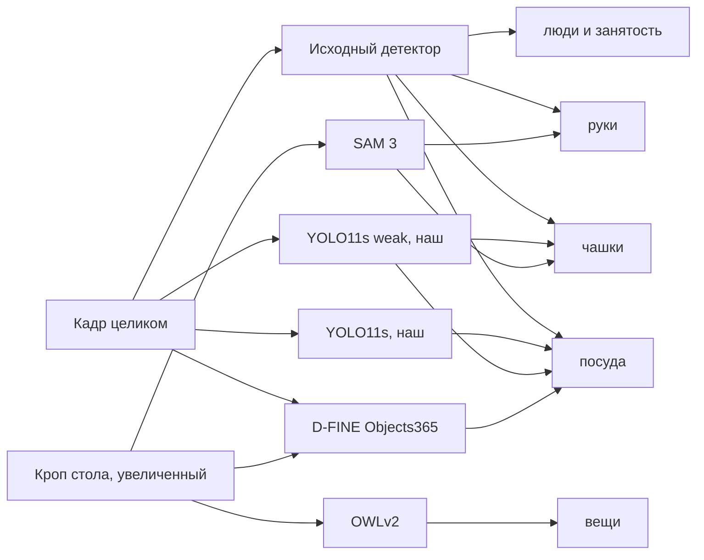
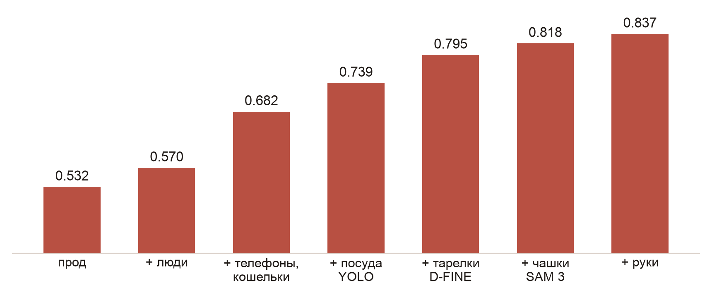

# Состояние столов в кафе по камере наблюдения

**3 место** в кейсе «Оператор зала / Table State» студенческого хакатона RASCAR.HACK (ИТМО, ноябрь 2026).
Команда kozik: [Арина Козловская](https://github.com/ore-sha) и [Владислав Будашов](https://github.com/PerfectStorm11).

*Computer vision pipeline that counts people, hands, cups, dishes and personal items on every table of a cafe from a
ceiling CCTV frame. 3rd place at RASCAR.HACK 2026 (case 2).*

## Задача

Компания КИРА делает систему видеоаналитики для кафе. Камера висит над залом и раз в 30-60 секунд присылает кадр.
По каждому столу на кадре нужно сказать:

- сколько за ним людей, рук, чашек, посуды и личных вещей (телефоны, кошельки);
- с какой вероятностью стол занят.

Из этого персонал получает подсказки: гости сели, пора убрать посуду, кто-то забыл телефон.

Метрика: `0.2 · AP(занятость) + 0.8 · среднее по 5 классам max(0, 1 − WAPE)`.

Почему это было непросто:

- Мало разметки. В train 39 кадров и 231 стол, в каждом классе 19-29 объектов. В test 800 кадров.
- 90% столов пустые. Одна лишняя тарелка на пустом столе штрафуется так же, как пропуск.
- Мелкие объекты. Телефон на столе занимает 20-30 пикселей кадра 1280×720.
- Свет. Ночью камера переходит в ИК-режим (19% test), днём солнце пересвечивает стол у окна (41% кадров test сняты в 14-19 ч).
- Готовый детектор организаторов не знает тарелок и вещей, а руки и чашки часто пропускает.

## Решение

Одной модели, которая хорошо считает всё, мы не нашли. Классы в метрике независимы, поэтому для каждого класса
собрали свои источники: шесть детекторов (четыре готовых и два своих дообученных YOLO) и правила поверх них.



| класс | как считаем |
|---|---|
| люди, занятость | детекции людей со своей привязкой к столу: зона над столом и положение ног, чтобы не засчитывать прохожих |
| руки | три ступени, каждая только для занятых столов, где рук пока ноль: исходный детектор -> рамка стола, поднятая на 20% (рука с телефоном над краем) -> SAM 3 |
| чашки | максимум из исходного детектора, нашего YOLO и SAM 3 |
| посуда | подносы, голосование трёх YOLO и тарелки D-FINE |
| вещи | OWLv2 по увеличенному кропу стола, запросы «телефон» и «кошелёк» |

Свои модели. YOLO11s дообучен на 45 исторических кадрах этой же камеры (610 боксов). Второй YOLO11s учится ещё и на
train со слабой разметкой: для стола с k объектами берём k самых уверенных боксов первой модели.

Почему кропы. Модели сжимают вход до своего размера (D-FINE до 640×640), и на целом кадре телефон почти исчезает.
Готовым моделям «по описанию» (OWLv2, SAM 3) мы даём вырезанный и увеличенный стол. Наши YOLO обучены на целых кадрах
в полном разрешении, им привычнее целый кадр.

## Как проверяли

По правилам соревнования подбирать параметры по test нельзя, поэтому всё решалось на двух днях train:

- метрика считается отдельно на 25.10 и 26.10, шаг принимается, только если он не хуже ни на одном дне;
- порог берётся из середины плато, а не на пике;
- модели со слабой разметкой обучаются на одном дне и оцениваются на другом;
- устойчивость каждого шага проверена бутстрепом по 31 временному эпизоду (2000 выборок).

## Результат

Валидация на train выросла с 0.532 (готовый детектор) до **0.837**, public на Kaggle 0.755.



| класс | готовый детектор | наше решение |
|---|---|---|
| люди | 0.63 | 0.84 |
| руки | 0.68 | 0.80 |
| чашки | 0.64 | 0.90 |
| посуда | 0.17 | 0.87 |
| вещи | 0.00 | 0.60 |

*1 − WAPE, среднее двух дней train.*

Всего проверили около 80 гипотез. Не сработали VLM (Qwen2.5-VL, Qwen3-VL) как счётчик и как фильтр, шесть отдельных
детекторов рук, более крупные модели (OWLv2-large, YOLO11m, CountGD++, OmDet-Turbo, WeDetect) и сглаживание по
соседним кадрам. Подробности, таблица вклада каждого шага и разбор оставшихся ошибок лежат в [REPORT.md](REPORT.md).

## Ограничения

- Стол у окна днём: солнце пересвечивает кадр, и руки сливаются со светлым ноутбуком. Здесь остаётся большая часть ошибок.
- Вещи: бумаги и тетради детекторы путают с меню и салфетками, а в train всего 10-18 вещей в день.
- Валидация маленькая: на день в каждом классе 4-20 объектов.
- Скорость: около 11 с на кадр на T4, основное время уходит на SAM 3. Без SAM 3 около 5 с на кадр при валидации 0.807.

## Запуск

Нужны Python 3.12 и GPU (проверено на Kaggle T4, около 2.5 ч на 800 кадров) или Apple Silicon (MPS, дольше).

```bash
pip install -r requirements.txt

# данные соревнования в репозиторий не входят
kaggle competitions download rascar-hack-case-2 -p data
unzip -q data/rascar-hack-case-2.zip -d data/raw

# веса SAM 3 выдаются по запросу на huggingface.co/facebook/sam3
huggingface-cli login

python pipeline/run.py --weights weights --sam3 hf
# -> out/pipeline_out/submission_v17.csv
```

Без `--sam3` собираются промежуточные версии v12 и v13. Все предобученные модели закреплены по commit на Hugging Face,
запуск с нуля на Kaggle T4 воспроизводит отправленный файл побайтно (md5 v17: `8c92d54517489701ce3f4f2748ffa848`).

Обучение своих YOLO с нуля:

```bash
python src/yolo_aux.py prepare && python src/yolo_aux.py train   # YOLO11s на 45 кадрах
python src/yolo_weak.py                                          # слабая разметка train + дообучение
```

## Структура

| путь | что внутри |
|---|---|
| `pipeline/run.py` | запуск всех детекторов по test, кэши в `out/pipeline_cache` |
| `pipeline/assemble.py` | сборка ответа из кэшей, правила по классам |
| `src/` | OWLv2, YOLO, SAM 3, метрика соревнования |
| `exp/people_ctx/` | привязка людей к столам |
| `exp/det_closed/` | D-FINE Objects365 для тарелок |
| `weights/` | наши дообученные YOLO11s |

## Команда

- **Арина Козловская** ([@ore-sha](https://github.com/ore-sha)): пайплайн и валидация, OWLv2, дообучение YOLO и слабая разметка, SAM 3, правила для рук и чашек.
- **Владислав Будашов** ([@PerfectStorm11](https://github.com/PerfectStorm11)): привязка людей к столам, тарелки D-FINE, кошельки, эксперименты с VLM и RF-DETR.

## Модели и лицензии

OWLv2 base (Apache-2.0), D-FINE-X Objects365 (Apache-2.0), SAM 3 (SAM License), YOLO11s (AGPL-3.0, наши веса
производные). Закрытых облачных моделей и API в решении нет, ручной разметки test нет.
